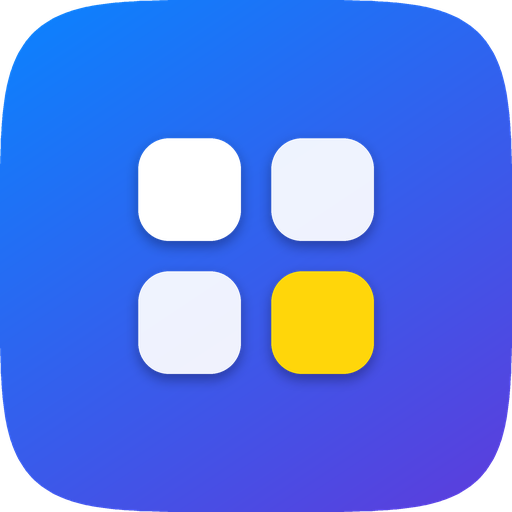

# Yogi Launcher

A clean, fast home screen for Android. It is iPhone-simple, has HyperOS-style folders, and adds advanced extras.
It's small (only AndroidX libraries, no tracking, no ads) and works fully offline.

## Home screen
* **Your wallpaper** shows behind everything, with a frosted **dock** for 4 apps (labels hidden, as on iPhone).
* **Beautiful, uniform icons**: every app icon is redrawn in one shape.
  * Shapes: **Squircle** (continuous curve, as on iPhone), Circle, Rounded square or Pebble.
  * Modern adaptive icons are cut to the shape; old icons sit on a clean white tile.
  * **Themed icons** (Android 13 monochrome layers, or a soft tint) for a calm look.
* A **clock widget** on page 1: time, date, battery and next alarm.
* **Pages** with smooth, springy swiping and page dots. Tap the dots to search.
* **Fast**: icons are drawn once and cached on disk, so the home screen opens instantly. Each icon is a single
  hand-drawn view, with no heavy layouts.

## Editing (jiggle mode)
* **Hold an icon** to open its menu. Keep holding and move, and the menu turns into a **drag**.
* **Hold empty space** for edit mode: icons wiggle, show a **−** to remove, and display Done / Widget / Settings.
* **Drop an icon on another** to make a **folder**. It gets a smart name: Games, Social, Photos, Google…
* Drop onto an icon's edge to **swap** the two. Drag to the screen edge to **change page**, and a new page appears at
  the end.

## Folders (HyperOS style)
* The folder tile shows a 3×3 preview of its apps.
* It opens **large and centred** over a **blurred** home screen (Android 12+), with big, easy icons.
* Tap the title to rename it. Hold an app to remove it from the folder or drag it out.

## Long-press menu
* **The app's latest notification**: read it, and tap to open it.
* **App shortcuts** (for example "New message" or "Scan QR"), with their own icons.
* Edit Home Screen · Remove from Home · App info · **Hide app** · Uninstall.

## Notification badges
* Red **count badges** (or dots) on icons, and summed on folders.
  * They need notification access: Settings → *Notification badges* → allow.

## App Library and search: swipe up
* **Suggestions** (your most-opened apps), then all apps **A–Z** with a letter scrubber on the right.
* **Smart search**:
  * Search apps by name, by word, by initials ("gm" → Google Maps) or by package.
  * A **calculator** right in the box: `1250*13%` = 162.5 (tap to copy).
  * **Search the web, Play Store or YouTube** for anything.
* Hold an app to add it to Home or drag it there. Pull down at the top to close.

## Gestures
* Swipe **up**: App Library · swipe **down**: notification shade (or search) · **double-tap** empty space: lock the
  screen (optional; uses Android's accessibility lock, Android 9+) · **Home button**: close everything and go back to
  page 1.

## Widgets page (swipe right)
* Add any **real Android widget** (clock, weather, calendar, notes, music…) with rounded corners. Hold one to
  remove it.

## Settings
* Default launcher, badges and lock status.
* Icon shape, size, style, labels and badge style.
* 4 or 5 columns, the clock, dock glass, and whether new apps go to Home.
* Swipe-down action, double-tap lock.
* Hidden apps, wallpaper, layout reset, and rebuilding the icon cache.

## First start
The launcher builds a tidy home screen for you:
* the **dock** gets phone, messages, browser and camera
* **page 1** gets popular apps (WhatsApp, YouTube, eSewa, Khalti, your Yogi apps…)
* **smart folders** are made automatically: Google, Games, Social, Utilities…

## Building
Put this folder in its own GitHub repository. **Actions** then builds **YogiLauncher.apk** (Release `vNN`).
Package `com.yogi.launcher`. Kotlin, Android 5.0+.
